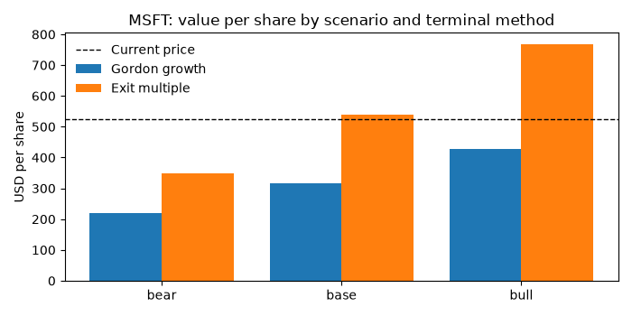

# dcf-valuation

[](https://github.com/robinrhs/dcf-valuation/actions/workflows/ci.yml)


A transparent discounted cash flow (DCF) model for US public companies that pulls its
financials from the official SEC EDGAR API and adds a reverse DCF showing which growth
today's share price already implies.

> **Not investment advice.** This is an educational tool. Its output depends entirely
> on the assumptions you feed it and says nothing reliable about future share prices.

<!-- TODO screenshot: terminal recording (GIF) of `python -m dcf value MSFT --config config/msft.yaml` -->

## What it does and why

A DCF values a business as the present value of the cash it will generate. Most student
DCFs live in spreadsheets with hand-copied numbers. This project builds the same model
in readable Python so every step can be traced and tested:

- **Official data:** annual 10-K figures come from SEC EDGAR (`company_tickers.json` for
  ticker -> CIK, the `companyfacts` XBRL API for the numbers), not from scraped sites.
- **Full chain:** historicals -> WACC -> unlevered FCF projection (bull / base / bear)
  -> terminal value with two methods side by side -> equity bridge -> value per share
  vs. current price.
- **Built-in scepticism:** implied exit multiple and implied perpetual growth
  cross-checks, terminal value share of EV, a WACC x growth sensitivity grid and a reverse
  DCF.
- **Assumptions in YAML**, with documented and dated default sources.

## Quickstart

Requires [uv](https://docs.astral.sh/uv/) and Python 3.11+.

```bash
git clone https://github.com/robinrhs/dcf-valuation.git
cd dcf-valuation
uv sync

# The SEC asks every client to identify itself as "Name email".
export SEC_USER_AGENT="Your Name your.email@example.org"

# Live run: SEC EDGAR financials + yfinance price/beta, default assumptions
uv run python -m dcf value MSFT --scenario base

# Case-study assumptions, all three scenarios
uv run python -m dcf value MSFT --config config/msft.yaml --scenario all

# Just look at the extracted 10-K line items and which XBRL tags were used
uv run python -m dcf historicals MSFT

# Fully offline, reproducible demo on a synthetic fixture (no network at all)
uv run python -m dcf value EXMPL --offline \
    --fixture tests/fixtures/companyfacts_example.json --config config/example_offline.yaml
```

Useful flags: `--years 5..10`, `--mid-year / --no-mid-year`, `--price`, `--beta`,
`--offline` (cache and YAML only), `--refresh` (ignore the cache), `--export DIR` (CSV of
the projection and sensitivity grid plus a JSON summary).

If `SEC_USER_AGENT` is not set, a neutral placeholder (`dcf-valuation research-tool
admin@example.com`) is sent and a note is printed. Please set your own. Responses are
cached in `.cache/sec/` (git-ignored, 7-day freshness) and requests are throttled to five
per second, below the SEC's limit of ten.

## Example output

### Offline demo (synthetic fixture, reproducible)

`uv run python -m dcf value EXMPL --offline --fixture tests/fixtures/companyfacts_example.json --config config/example_offline.yaml`
(excerpt; "Example Corp" is fictional, price and beta are made up):

```text
PROJECTION
USD m                       FY2026E  FY2027E  FY2028E  FY2029E  FY2030E
-----------------------------------------------------------------------
Revenue growth                 9.0%     7.4%     5.8%     4.1%     2.5%
Revenue                       1,199    1,287    1,361    1,418    1,453
EBIT margin                   23.2%    23.4%    23.6%    23.8%    24.0%
EBIT                            278      301      321      337      349
- Taxes on EBIT                  58       63       67       71       73
= NOPAT                         220      238      254      267      275
+ D&A                            58       62       65       68       70
- Capex                          73       78       83       86       88
- Increase in NWC                11        7        6        5        3
= Unlevered FCF                 194      214      230      244      254
Discount factor               0.957    0.876    0.802    0.735    0.673
PV of UFCF                      185      188      185      179      171

TERMINAL VALUE AND EQUITY BRIDGE
USD m                       Gordon growth  Exit multiple
--------------------------------------------------------
Assumption                       g = 2.5%   11.0x EBITDA
Terminal value (year N)             3,883          4,604
PV of terminal value                2,612          2,964
PV of explicit FCF                    908            908
Enterprise value                    3,520          3,872
- Debt                                260            260
+ Cash & ST investments               280            280
= Equity value                      3,540          3,892
Diluted shares (m)                     99             99
Value per share (USD)               35.76          39.31
Current price (USD)                 30.00          30.00
Upside / downside                   19.2%          31.0%
TV share of EV                      74.2%          76.6%

CROSS-CHECKS
  Gordon TV implies an exit multiple of      9.7x EBITDA
  Exit-multiple TV implies perpetual growth  3.3%
  Implied ROIC on new capital (final year)   32.2%

SENSITIVITY: value per share (Gordon), rows = WACC, columns = terminal growth
WACC \ g    1.5%  2.0%  2.5%  3.0%  3.5%
----------------------------------------
8.21%         37    39    42    45    49
8.71%         34    36    39    41    45
9.21%         32    34    36    38    41
9.71%         30    32    33    35    37
10.21%        28    30    31    33    35

REVERSE DCF
  The price of USD 30.00 implies constant revenue growth of 1.6% p.a. for 5 years
  (holding this scenario's margins, reinvestment, WACC and terminal growth fixed).
```

### Live run: Microsoft (snapshot of 2 November 2026)

`uv run python -m dcf value MSFT --config config/msft.yaml --scenario all`, using the
FY2026 10-K (year ended 30 June 2026) and the yfinance price at run time. Excerpt:

```text
HISTORICALS
USD m (10-K)                 FY2022   FY2023   FY2024   FY2025   FY2026
-----------------------------------------------------------------------
Revenue                     198,270  211,915  245,122  281,724  331,839
  growth                        n/a     6.9%    15.7%    14.9%    17.8%
EBIT (operating income)      83,383   88,523  109,433  128,528  155,237
  margin                      42.1%    41.8%    44.6%    45.6%    46.8%
D&A                          14,600   13,500   20,000   28,000   39,000
Capex                        23,886   28,107   44,477   64,551  115,948
Operating NWC               -16,535  -17,808  -21,408  -21,436  -33,108
UFCF (t = 21%)                  n/a   56,599   65,575   65,014   57,361

WACC
Input                       Value
---------------------------------
Risk-free rate              4.98%
Beta                         1.04
Equity risk premium         4.20%
Cost of equity (CAPM)       9.37%
Pre-tax cost of debt        5.58%
After-tax cost of debt      4.41%
Equity weight E/V           99.0%
Debt weight D/V              1.0%
WACC                        9.32%

TERMINAL VALUE AND EQUITY BRIDGE (base)
USD m                       Gordon growth  Exit multiple
--------------------------------------------------------
Assumption                       g = 3.0%   18.0x EBITDA
Enterprise value                2,422,097      4,034,669
= Equity value                  2,458,646      4,071,218
Value per share (USD)              329.89         546.25
Current price (USD)                524.52         524.52
TV share of EV                      72.9%          83.7%

CROSS-CHECKS
  Gordon TV implies an exit multiple of      9.4x EBITDA
  Exit-multiple TV implies perpetual growth  5.9%

REVERSE DCF
  The price of USD 524.52 implies constant revenue growth of 17.0% p.a. for 7 years

SCENARIO SUMMARY (price USD 524.52, WACC 9.32%)
Scenario    Growth Y1  Margin YN  Gordon/share  Upside  Exit/share  Upside
--------------------------------------------------------------------------
base            15.0%      44.0%        329.89  -37.1%      546.25    4.1%
bull            19.0%      47.0%        439.93  -16.1%      770.17   46.8%
bear            10.0%      40.0%        233.49  -55.5%      359.77  -31.4%
```

(Rows of the bridge table and the sensitivity grid are omitted here for length. Beta is
printed rounded to two decimals; the calculation uses the full value.)

How to read this: with a 9.3% WACC and 3% terminal growth, the Gordon method is far below
the market price, while an 18x exit multiple lands close to it. The cross-check explains
the gap: 18x EBITDA is equivalent to growing free cash flow at about 5.9% forever. The
reverse DCF tells the same story from another angle. It does **not** show that the share
is over- or undervalued. It shows how much the answer depends on terminal assumptions.



The full walk-through, with commentary, is in
[`notebooks/msft_case_study.ipynb`](notebooks/msft_case_study.ipynb). It was executed with
live data on 2 November 2026, a few minutes before the CLI run above, so the share price
differs slightly.

## Method

### 1. Historical data (SEC EDGAR, XBRL)

`xbrl.py` keeps only annual facts from `10-K` / `10-K/A` filings (`fp = FY`) with a
duration of 350-380 days, so quarters inside a 10-K are dropped. When several filings report
the same period, the most recently filed value wins, so restatements replace the original.
Each line item has an ordered list of fallback tags, applied year by year:

| Line item | XBRL tags tried in order |
|---|---|
| Revenue | `RevenueFromContractWithCustomerExcludingAssessedTax`, `Revenues`, `SalesRevenueNet`, `RevenueFromContractWithCustomerIncludingAssessedTax` |
| EBIT | `OperatingIncomeLoss` |
| D&A | `DepreciationDepletionAndAmortization`, `DepreciationAndAmortization`, `DepreciationAmortizationAndAccretionNet`, `Depreciation + AmortizationOfIntangibleAssets`, `Depreciation` |
| Capex | `PaymentsToAcquirePropertyPlantAndEquipment`, `PaymentsToAcquireProductiveAssets` |
| NWC items | `AccountsReceivableNetCurrent`, `InventoryNet`, `AccountsPayableCurrent`, `ContractWithCustomerLiabilityCurrent` / `DeferredRevenueCurrent` |
| Cash | `CashAndCashEquivalentsAtCarryingValue` (+ `ShortTermInvestments` / `MarketableSecuritiesCurrent`) |
| Debt | `LongTermDebt` or `LongTermDebtNoncurrent + LongTermDebtCurrent`, plus `ShortTermBorrowings` / `CommercialPaper` |
| Diluted shares | `WeightedAverageNumberOfDilutedSharesOutstanding` |

Missing items are reported as warnings and treated as zero where they are used.

### 2. WACC

$$r_E = r_f + \beta \cdot ERP \qquad r_D^{after\ tax} = r_D (1 - t)$$

$$WACC = \frac{E}{D+E} r_E + \frac{D}{D+E} r_D (1 - t)$$

`E` = share price x diluted shares (market value). `D` = book debt (a proxy for its
market value). The pre-tax cost of debt defaults to `r_f + credit spread`. Unlevered FCF
is the cash available to *all* capital providers, so it is discounted at the WACC, not
at the cost of equity.

### 3. Unlevered free cash flow

$$UFCF_t = EBIT_t (1 - t) + D\&A_t - Capex_t - \Delta NWC_t$$

with `Revenue_t = Revenue_{t-1} (1 + g_t)`, `EBIT_t = margin_t x Revenue_t`,
D&A, capex and NWC as percentages of revenue, and operating NWC = receivables +
inventory - payables - current deferred revenue.

- **Growth path:** linear fade from the year-1 rate to the terminal growth rate, reached
  in the final explicit year, so the business is in a steady state when the TV starts.
- **Margin / capex / D&A paths:** linear glide from today's level to a target level.
- **Defaults:** empty (`null`) YAML values fall back to history over the last three fiscal
  years: the revenue CAGR between the first and last of them (two growth periods, i.e. a
  2-year CAGR), the last EBIT margin, and 3-year average reinvestment ratios.
- **Scenarios:** bull / base / bear are separate YAML blocks (see `config/msft.yaml`).

### 4. Discounting and mid-year convention

$$DF_t = \frac{1}{(1 + WACC)^{t}} \quad \text{(end of year)} \qquad DF_t = \frac{1}{(1 + WACC)^{t - 0.5}} \quad \text{(mid-year)}$$

Under the mid-year convention, the Gordon TV is discounted with `N - 0.5` because it values
a stream of mid-year cash flows. The exit-multiple TV is a sale price at the end of year
`N` and is discounted with `N`.

### 5. Terminal value, side by side

$$TV^{Gordon}_N = \frac{UFCF_N (1 + g)}{WACC - g} \qquad TV^{Exit}_N = EBITDA_N \times \text{multiple}$$

Cross-checks. Without the mid-year convention both TVs sit at the end of year `N`:

$$\text{implied multiple} = \frac{TV^{Gordon}_N}{EBITDA_N} \qquad \text{implied } g = \frac{TV^{Exit}_N \cdot WACC - UFCF_N}{TV^{Exit}_N + UFCF_N}$$

Under the mid-year convention the Gordon TV is discounted from `N - 0.5` and the exit TV
from `N`, so they refer to dates half a year apart. Before comparing, the code moves each to
the other's date with a factor of `(1 + WACC)^0.5`:

$$\text{implied multiple} = \frac{TV^{Gordon}_N (1 + WACC)^{0.5}}{EBITDA_N} \qquad \text{implied } g = \frac{\widetilde{TV} \cdot WACC - UFCF_N}{\widetilde{TV} + UFCF_N}, \quad \widetilde{TV} = \frac{TV^{Exit}_N}{(1 + WACC)^{0.5}}$$

Both cross-checks are shown as n/a when `UFCF_N` or `EBITDA_N` is not positive.

The report also shows the TV share of enterprise value and the implied return on new
capital in the final year, `ROIC = g / reinvestment rate` with reinvestment rate =
(capex - D&A + dNWC) / NOPAT.

### 6. Equity bridge

$$\text{Equity} = EV - \text{Debt} + \text{Cash \& ST investments} \qquad \text{Value per share} = \frac{\text{Equity}}{\text{Diluted shares}}$$

Upside = value per share / current price - 1.

### 7. Sensitivity and reverse DCF

- **Grid:** Gordon value per share for WACC +/- 1pp and terminal growth +/- 1pp in 0.5pp
  steps (configurable). Cells where WACC <= g are undefined.
- **Reverse DCF:** `scipy.optimize.brentq` solves
  `value_per_share(g) - price = 0` for one constant revenue growth rate `g` over the
  explicit horizon, with margins, reinvestment, WACC and terminal growth held fixed. A
  test checks the round trip: re-valuing at the solved `g` reproduces the price.

## Key assumptions and default sources

Defaults live in [`src/dcf/defaults.yaml`](src/dcf/defaults.yaml). Override any of them in
your own YAML (`--config`). Market inputs are **snapshots that go stale and must be
updated** before you rely on the output.

| Input | Default | Source / date |
|---|---|---|
| Risk-free rate | 4.98% | 10-year US Treasury yield, FRED series DGS10, 2026-10-29 |
| Equity risk premium | 4.20% | Damodaran implied ERP (trailing 12-month cash flows, adjusted payout), 2026-10-01 |
| Credit spread | 1.0% (MSFT case: 0.6%) | Assumption; compare with Damodaran's rating/spread table or bond yields |
| Tax rate | 21% | US federal statutory rate (state taxes ignored) |
| Beta, price | live | yfinance (Yahoo beta: 5-year monthly vs. S&P 500); overridable in YAML |
| Horizon | 5 years (MSFT case: 7) | Allowed range 5-10 |
| Convention | mid-year | toggle with `--no-mid-year` |

## Limitations: when this DCF is weak

- **Terminal value dominates.** In the runs above, 70-85% of EV comes from the TV, so the
  result is mainly a statement about WACC, `g` and the exit multiple.
- **Equity bridge is simplified.** Operating leases, minority interests, preferred stock,
  pension deficits, equity-method investments and long-term investment portfolios are
  *not* included. Book debt is used as a proxy for market value. Stock-based compensation
  is not treated as a cash cost.
- **XBRL coverage is imperfect.** Companies use custom extension tags that the
  `companyfacts` API does not include. For Microsoft, total D&A is not available under a
  standard tag, so the loader uses `Depreciation + AmortizationOfIntangibleAssets`, which
  may understate it. Always check the `historicals` output against the 10-K.
- **Fiscal-year labels** are the calendar year of the period end. Fiscal years are not
  calendarised across companies.
- **Taxes:** one flat rate on EBIT. There are no NOLs, no deferred taxes and no negative-EBIT
  tax asymmetry.
- **CAPM inputs are estimates:** the regression beta is backward-looking, and the ERP and
  risk-free rate change daily.
- **Poor fit** for banks and insurers (debt is operating, not financing), for early-stage
  or loss-making companies (negative FCF and no meaningful terminal year), for cyclicals at
  peak or trough margins, and for holding companies. Use other methods there.
- **yfinance** is an unofficial Yahoo Finance wrapper and can break or be rate-limited.
  Override price and beta in YAML if needed.

## Project structure

```text
dcf-valuation/
├── src/dcf/
│   ├── sec_client.py     # EDGAR download: User-Agent, throttling, file cache (I/O)
│   ├── xbrl.py           # companyfacts JSON -> annual 10-K line items, tag fallbacks
│   ├── financials.py     # historical ratios: CAGR, margins, reinvestment, hist. UFCF
│   ├── wacc.py           # CAPM, after-tax cost of debt, weights, WACC
│   ├── projection.py     # scenario resolution, growth/margin paths, UFCF projection
│   ├── valuation.py      # discounting, mid-year, Gordon/exit TV, cross-checks, bridge
│   ├── sensitivity.py    # WACC x terminal growth grid
│   ├── reverse_dcf.py    # implied growth via brentq
│   ├── market.py         # MarketDataProvider interface, yfinance + static providers
│   ├── assumptions.py    # YAML loading and validation (deep merge onto defaults)
│   ├── defaults.yaml     # default assumptions with sources and dates
│   ├── model.py          # orchestration: one function from inputs to full result
│   ├── report.py         # text report, CSV/JSON export
│   └── cli.py            # `python -m dcf value|historicals`
├── config/
│   ├── msft.yaml         # Microsoft case-study assumptions
│   └── example_offline.yaml
├── notebooks/msft_case_study.ipynb
├── tests/                # offline pytest suite + synthetic companyfacts fixture
└── .github/workflows/ci.yml
```

The finance maths (`wacc`, `projection`, `valuation`, `sensitivity`, `reverse_dcf`,
`financials`, `xbrl`) has no I/O and no UI code, so it can be tested in isolation.

## Tests

```bash
uv run pytest
uv run ruff check . && uv run ruff format --check .
```

The tests run fully offline (network calls are blocked in `conftest.py`) against a small
hand-made `companyfacts`-shaped fixture. They cover discounting, the mid-year toggle, the
Gordon formula, the exit-multiple TV, the implied multiple/growth round trip, bridge
arithmetic, WACC, the reverse DCF round trip and XBRL tag fallbacks (incl. restatements and
quarterly facts inside a 10-K).

To re-run the notebook: `uv sync --group notebook`, then
`cd notebooks && uv run jupyter nbconvert --to notebook --execute --inplace msft_case_study.ipynb`.

## Data and licence notes

SEC EDGAR data is public and is downloaded at run time. It is not stored in this
repository. The test fixture is synthetic. Market data from yfinance is subject to Yahoo's
terms and is not redistributed here.

## License

[MIT](LICENSE) © 2026 Robin-Philip Rehschuh
